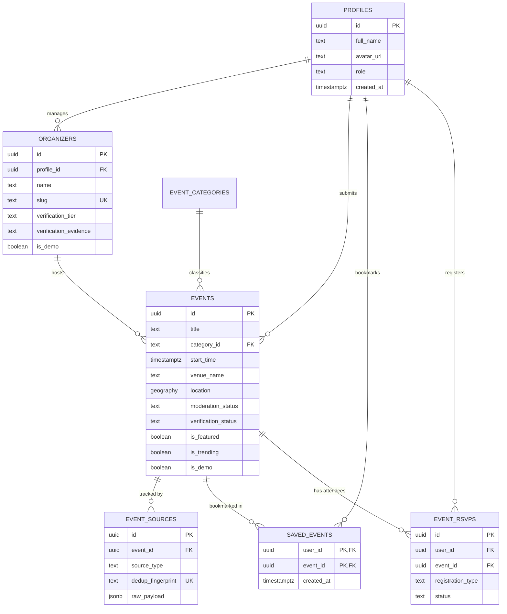
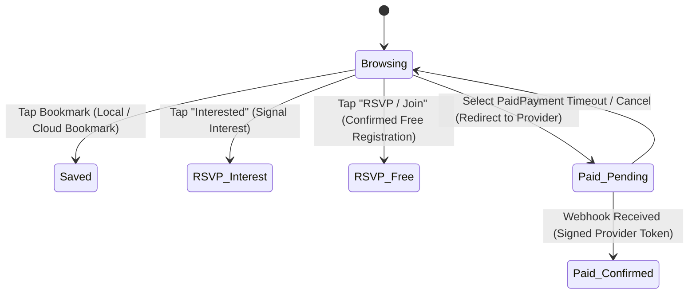

# Social Buddy — Backend Architecture & Data Design

> **Project:** Social Buddy  
> **Repository:** `https://github.com/Themeta-verse/SOCIAL-BUDDY.git`  
> **Branch:** `main`  
> **Hackathon:** VecnaVerse National Level Hackathon  
> **Problem Statement 1:** Hyperlocal Event Discovery & Community Engagement  
> **Target Stack:** Expo (SDK 58) / React Native / TypeScript / Supabase (PostgreSQL 15+ & PostGIS)

---

## 1. Executive Summary & Existing Prototype Continuity

Social Buddy has been successfully scaffolded and verified as an Expo Go compatible mobile application utilizing React Native and TypeScript. In Phase 2, we established:
- A dark charcoal (`#090B0E`, `#11141A`, `#151922`) interface with warm amber accents (`#F59E0B`).
- Live geospatial distance calculations via Haversine formula on active coordinates.
- Continuous radius discovery slider (1–50 km) linked to multi-section event feeds (Featured, Trending, Upcoming).
- Horizontal category filtering across 8 standard categories (`All`, `Music`, `Comedy`, `Workshops`, `College`, `Sports`, `Meetups`, `Parties`).
- Full Event Detail screen with local RSVP scheduling and bookmark persistence via `@react-native-async-storage/async-storage`.

This document presents the **Phase 3 Backend Architecture**, establishing a production-conscious, multi-user design backed by PostgreSQL and PostGIS on Supabase without compromising the existing Expo Go offline experience.

---

## 2. Normalized Relational Data Model

The schema is formally defined in [`supabase/migrations/20261024000001_initial_hyperlocal_schema.sql`](file:///c:/Users/vijay/OneDrive/Desktop/SOCIAL-BUDDY/supabase/migrations/20261024000001_initial_hyperlocal_schema.sql).

### 2.1 Entity Relationship Diagram



### 2.2 Classification & Moderation State Lifecycle

Every event in the system is strictly partitioned across five distinct moderation states:
1. `demo`: Seeded demonstration events built for testing UI layouts without asserting real-world presence.
2. `pending`: Community-submitted events placed in the administrative moderation queue.
3. `approved`: Moderated and public events meeting community safety guidelines.
4. `rejected`: Submissions that failed moderation (rejection reason stored in `rejection_reason`).
5. `flagged`: Published events flagged by users for review (e.g. venue cancelled, offensive content).

### 2.3 Verification Tiers

To eliminate fabricated social proof and false authenticity claims:
- **`unverified`**: Default for user-submitted and community events. No checkmark or badge displayed.
- **`community_vouched`**: Events submitted by campus organizations or known community ambassadors with documented contact info.
- **`partner_verified`**: Legitimate commercial venues, festivals, or university councils with verified domain ownership and direct organizer identity verification.
- **`official_institution`**: City municipal bodies, accredited universities, or certified concert arenas.

---

## 3. Hyperlocal PostGIS Query Engine

### 3.1 Spatial Storage & Coordinates
Events store latitude and longitude in a native PostGIS `geography(Point, 4326)` column. This guarantees spherical Earth distance calculations without distortion at different latitudes.

### 3.2 Dynamic Radius Query via Spatial RPC
Hyperlocal discovery is powered by the server-side RPC `get_hyperlocal_events()`:
```sql
select * from public.get_hyperlocal_events(
  user_lat := 12.9716,
  user_lon := 77.5946,
  radius_km := 15.0,
  filter_category := 'Music',
  include_demo := true,
  max_limit := 25,
  page_offset := 0
);
```

**Key Execution Rules:**
1. **Strict Spatial Filtering:** `st_dwithin(location, st_makepoint(user_lon, user_lat)::geography, radius_km * 1000.0)` guarantees that distant events are never included.
2. **Computed Distance:** Returns `distance_km` calculated on the database server to one decimal place (`round(...)`), avoiding client-side math drift.
3. **Featured & Trending Subsets:** Featured and trending rankings are sorted **within** the spatial envelope. An event cannot be "Featured" if it is outside the selected radius.
4. **Temporal Window:** Automatically excludes events that concluded more than 6 hours prior (`e.start_time >= (now() - interval '6 hours')`).
5. **Spatial Index:** Accelerated by a GiST index (`create index idx_events_location on public.events using gist(location);`) enabling sub-10ms responses across 100,000+ spatial points.

---

## 4. Security, Authorization & Row-Level Security (RLS)

All client communication from Expo to Supabase runs over HTTPS using the standard **Anon Public Key**. Under no circumstances is the **Service Role Secret** packaged or bundled in the mobile application.

| Table | Operation | Allowed Actors | Enforcement Mechanism |
|---|---|---|---|
| `profiles` | SELECT | Public | `true` |
| `profiles` | UPDATE | Owner | `auth.uid() = id` (role modification blocked) |
| `organizers` | SELECT | Public | `true` |
| `organizers` | UPDATE | Organizer Owner / Admin | `auth.uid() = profile_id` (verification tier blocked) |
| `events` | SELECT | Public | `moderation_status = 'approved' OR is_demo = true OR submitted_by = auth.uid()` |
| `events` | INSERT | Authenticated User | Forces `moderation_status = 'pending'`, `is_featured = false` |
| `events` | UPDATE | Submitter / Moderator | Submitters can only edit while `pending`; cannot self-approve |
| `saved_events` | ALL | Bookmarking User | `auth.uid() = user_id` |
| `event_rsvps` | INSERT | Registering User | `auth.uid() = user_id` (free/interest only; paid blocked) |
| `event_rsvps` | SELECT | Registering User | `auth.uid() = user_id` (public queries use aggregated count) |

---

## 5. Event Ingestion & Deduplication Strategy

To maintain high data quality and avoid fictitious listings, Social Buddy implements three distinct ingestion pathways:

```
[Organizer Portal]       --> KYC & Domain Verification  --> Direct Ingestion (Partner Verified)
[Community Submission]   --> Automated Spam Filter      --> Moderation Queue (Pending Review)
[Approved Public Feeds]  --> Canonical RSS/JSON Parser  --> SHA-256 Fingerprint Check --> Ingestion
```

### 5.1 Ingestion Paths

1. **Organizer Portal (Self-Service):**
   * Registered organizers with claimed domain or institutional email submit events directly.
   * Requires venue address verification (OpenStreetMap / Google Geocoding).
2. **Community Submissions (In-App Form):**
   * College students and local citizens submit meetups, campus clubs, and pickup games.
   * Enters the `pending` queue; requires approval from a designated community moderator before appearing publicly.
   * Rate limited: Maximum 3 pending submissions per user per day.
3. **Approved Public Feeds (Whitelisted APIs):**
   * Automated cron ingestion from legitimate public event feeds (e.g. university campus calendars, cultural center RSS feeds).
   * **Explicit Constraint:** Social Buddy **will not** scrape private groups, bypass platform terms of service, or claim automated access to private social channels.

### 5.2 Deduplication Engine
Every incoming event generates a unique SHA-256 deterministic fingerprint:
```
dedup_fingerprint = SHA256(
  slugify(title) + "|" +
  format_iso_date(start_time) + "|" +
  round(venue_lat, 3) + "|" +
  round(venue_lon, 3)
)
```
If an event with the same fingerprint already exists in `event_sources`, the ingestion pipeline flags it as a duplicate and updates the existing record's metadata rather than spawning duplicate cards.

---

## 6. Registration & RSVP Semantics

To ensure user clarity and legal compliance, Social Buddy defines four distinct engagement states:



1. **Saved Event (Bookmark):** Stored in `saved_events`. Indicates personal interest for reminder notifications; does not hold a seat.
2. **Interest Signal:** Lightweight social count showing community excitement without claiming attendance.
3. **Confirmed Free RSVP:** Stored in `event_rsvps` (`registration_type = 'free_confirmed'`). Decrements available capacity for limited-capacity workshops.
4. **Paid Booking (Future Phase):**
   * Direct financial processing **is not implemented in this phase**.
   * When implemented, tickets will link to official ticketing partners (e.g. BookMyShow, Eventbrite, Luma) or use trusted server webhooks (Stripe / Razorpay). The mobile client will never self-assert payment confirmation.

---

## 7. Progressive Implementation & Transition Plan

To prevent breaking the active Expo Go demonstration prototype while adding backend functionality:

```
[UI Screen / Hook]
       |
[Events Service Layer] (src/services/eventsService.ts)
       |
       +---> If EXPO_PUBLIC_SUPABASE_URL is configured:
       |        Queries Supabase PostGIS RPC via @supabase/supabase-js
       |
       +---> If Offline / Supabase Not Configured:
                Falls back gracefully to Local Mock Events (src/data/mockEvents.ts)
```

### 7.1 Environment Variable Configuration
The application will read environment configuration via Expo’s public variable format:
- `EXPO_PUBLIC_SUPABASE_URL`: HTTPS endpoint of the Supabase project.
- `EXPO_PUBLIC_SUPABASE_ANON_KEY`: Safe public anon key for client RLS operations.

### 7.2 Safe Sequence of Implementation
1. **Milestone 3.1 (Complete):** Architecture specification and PostgreSQL/PostGIS schema migration draft.
2. **Milestone 3.2:** Introduce `src/services/eventsService.ts` with transparent mock-fallback dual mode.
3. **Milestone 3.3:** Add in-app community event submission screen (`src/screens/SubmitEventScreen.tsx`).
4. **Milestone 3.4:** Configure Supabase project, execute initial migration, and connect live testing with Expo Go.
